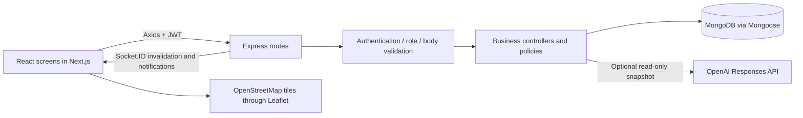
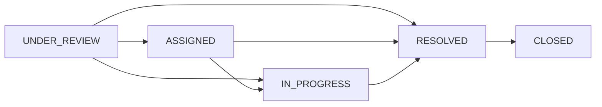

# DRECS — evaluator and viva guide

Prepared from the repository on 8 October 2026. Read this with [Project Information](PROJECT_INFORMATION.md) for exact validation expressions, [UI Review](UI_REVIEW.md) for verification evidence, and [Function Inventory](FUNCTION_INVENTORY.md) for named source functions and their call traces. “Implemented” means present and connected in the application; it does not mean independently certified or tested in every production condition.

## 1. Opening explanation

“DRECS is a Disaster Response and Emergency Coordination System. Citizens report incidents, authorities verify them before community visibility, volunteers offer help and receive assignments, and authorities coordinate shelters and resources. The supply module tracks demand, reserved stock, dispatch, receipt and consumption. Live updates keep screens synchronized. An optional read-only AI assistant explains authorized operational data; decisions and inventory changes remain with authorities.”

The problem is fragmented information: an unverified report can mislead responders, two people can reserve the same supplies, and a status label alone does not prove that help or goods reached a destination. DRECS makes those decisions explicit and records their consequences.

## 2. Requirements and scope

### Functional requirements

1. Register and authenticate users; authorize each operation using their current account state.
2. Accept structured incident reports with a map location and enforce five reports per India calendar day.
3. Keep pending/rejected reports private to their reporter and authorized reviewers; publish only approved reports.
4. Review volunteer offers, create assignments and enforce a meaningful response lifecycle.
5. Show shelter capacity, occupancy, status, facilities and contact instructions; edit only through an explicit form.
6. Maintain resource lots, incident reservations and available stock.
7. Connect resource lots to explicit storage locations; record shelter needs and controlled deliveries.
8. Suggest matching nearby stock using recorded demand, units and coordinates.
9. Notify users and refresh screens without discarding drafts.
10. Provide maps, approved-incident analytics and admin account controls.
11. Optionally answer planning questions using an authorized snapshot with human confirmation before stock changes.

### Non-functional requirements and practical limits

| Requirement | Current mechanism | Limit / work remaining |
| --- | --- | --- |
| Integrity | Validation, indexes, optimistic versions and multi-document transactions | No formal proof; integration tests cover selected races and rollbacks |
| Access control | JWT verification plus current database account/role checks | Authentication hardening, session revocation and broader security review remain |
| Responsiveness | Responsive layouts, mobile navigation, loading/error/empty states | Full device and assistive-technology matrix remains |
| Freshness | Socket invalidation, reconnect/focus refresh, visible-page polling | Not an offline or real-time guaranteed-delivery system |
| Maintainability | TypeScript, feature controllers, API wrappers, shared UI controls and policy helpers | Some older helpers/models remain unused; supply page can be split further |
| Scalability | MongoDB indexes and some filtered/paginated endpoints | Logistics overview loads whole lists; distance matching scans candidates |
| Availability | Persisted database records and recoverable fetch errors | No failover SLO, offline queue or disaster-grade operations certification |

Required environment: Node.js 20.19+ for the current development tooling, npm, Git, modern browser and transaction-capable MongoDB (Atlas or replica set). Internet is needed for Atlas, package installation, map tiles, remote fonts and optional AI. No GPU or vector database is required. These are compatibility requirements, not measured minimum RAM/CPU benchmarks.

## 3. Architecture and technology choices

| Technology | Use here | Why it was chosen / tradeoff |
| --- | --- | --- |
| Next.js 14.2.3 + React 18 | App Router, layouts, pages, client-side interactive screens | Organized routing and shared shell; data still comes from a separate Express API |
| TypeScript | UI, DTOs, controllers, hooks and policies | Catches shape/type mistakes at build time; does not validate incoming JSON at runtime |
| Tailwind CSS | Dark theme, spacing, responsive grids, focus states | Shared utility conventions; layout mistakes still require visual review |
| Express 4 | REST routing, middleware, JSON handling and health endpoint | Explicit request flow and modular controllers |
| MongoDB + Mongoose 8 | Documents, references, validation, indexes, transactions | Flexible nested location/history data; cross-document integrity must be explicitly enforced |
| Zod | Body schemas and environment validation | Rejects malformed data before controllers run |
| bcryptjs | Salted password hashing; work factor 10 in the user model | Original passwords cannot be read back |
| jsonwebtoken | Signed access tokens, default expiry 7 days | Convenient stateless credential; logout currently clears browser state rather than revoking the token globally |
| Axios | Shared base URL, bearer token attachment and response handling | Avoids repeating request setup in every screen |
| Socket.IO | Authenticated connections and event delivery | Clients re-fetch through the API after invalidation; reconnect support without custom socket framing |
| Leaflet / React Leaflet | Location selection, incident and shelter markers | Browser map interaction; tile access is an external dependency |
| Recharts | Incident, severity, volunteer and resource-lot charts | Declarative React charts, with readable tables for their data |
| Node test runner + mongodb-memory-server | Regression tests and disposable replica-set integration tests | Exercises transaction behavior without touching Atlas; initial binary download can be large |

Backend folders: routes expose endpoints; middleware authenticates/authorizes; controllers implement use cases; models define persistence; utils centralize validation/status rules; socket persists and pushes notifications. Client folders: app contains pages/layouts; components contains reusable UI; context owns authentication/socket connections; hooks manage lifecycle/refresh; lib wraps APIs; types defines shared client shapes.

### One request from click to database

1. A form collects input and provides immediate browser validation.
2. Its client API wrapper uses Axios, which adds the stored JWT.
3. Express authentication verifies the token and re-reads the user’s active status and role.
4. Role guards reject unauthorized operations; Zod validates the body.
5. The controller checks business rules, executes writes and returns a formatted response.
6. Successful authenticated mutations trigger a data_changed event; screens re-fetch permitted data.
7. Business notifications are persisted separately and pushed to the recipient. Notification failure is logged; a durable retry/outbox is not implemented.

## 4. Roles and permissions

| Role | Main responsibilities |
| --- | --- |
| Citizen | Register, report incidents, view approved reports, offer help, view own requests and assigned tasks |
| Volunteer | Supported account role with reporting/help capabilities; task access still depends on assignment ownership |
| Authority | Review reports and offers, manage response statuses, shelters, resources, supplies, maps and analytics |
| Admin | Authority operations plus role changes, activation/deactivation and account overview |

Public registration always creates a citizen. Approving an offer does not promote the account to authority or require changing its role to volunteer. Assignment ownership establishes task access. Admins cannot demote or deactivate themselves through the account endpoints. “Public incidents” means community-visible to authenticated users, not anonymous access to the entire database.

## 5. Every product function: purpose, working and pending details

| Function / screen | Why needed | How it works now | Pending / boundary |
| --- | --- | --- | --- |
| Registration | Identify reporters/responders | Name/email/password validation, unique email, bcrypt hash, citizen account and JWT | Email verification, OTP, recovery and login abuse throttling |
| Login/logout | Restrict access and end a browser session | Password comparison, active-account check, token/profile stored in browser; logout clears them | Global token revocation and refresh-token rotation |
| Show/hide password | Let users correct typing mistakes | Accessible button changes input type without changing value or submitting the form | Not an additional authentication factor |
| Dashboard | One place to find reports | Role-specific incident listings, filters, report links, authority review state | Consistent cancellation of out-of-order requests across every list |
| Report incident | Capture actionable information | Title, description, category, reporter-selected severity and required map point; optional GPS | No photo-upload workflow, automatic AI classification or dispatch to emergency services |
| Daily report limit | Reduce repeated submissions | Atomic daily slot reservation, five/day, India midnight reset; failed persistence releases slot | Not duplicate-content detection or identity verification |
| Incident approval | Prevent unverified community reports | PENDING becomes APPROVED or REJECTED; approval publishes and advances response stage | Appeal/re-review workflow is not implemented |
| Incident detail/timeline | Explain what is happening and who changed status | Authorized detail endpoint, status history and permitted next actions | Audit export and comprehensive change history for every entity |
| Offer help | Collect relevant skills and contact information | Validated skills/experience/message/mobile; one pending/approved offer per incident/user | Skill credentials and phone ownership are not verified |
| Volunteer review | Make acceptance operational | Approval creates an assignment and updates waiting incident in a transaction; rejection creates no task | Automated skills matching or scheduling optimization |
| My tasks | Give responders clear responsibility | Owner-only progression through acceptance, work and completion | GPS tracking, attendance, travel routing and outcome attachments |
| Volunteer Force | Let authorities inspect response capacity | Assignment/request-based responder view, search/filter/status and removal | A full separate editable volunteer-profile onboarding process |
| Shelter management | Know where people can stay | Capacity/occupancy validation, explicit edit form, facilities/contact, derived ACTIVE/FULL and explicit INACTIVE | Individual residents, bookings and automatic population forecasts |
| Resource inventory | Avoid allocating unavailable supplies | Lots with category/unit/quantity/availability; incident allocation/release and maintenance override | Batch expiry, accounting-grade replenishment/correction ledger |
| Storage linking | Know which source can send goods | Warehouse map point or shelter source; bind a resource lot once, preserving quantity | Relocation/rebinding and storage editing after creation |
| Shelter needs | Record actual demand rather than infer it | Explicit item/category/unit/quantity/urgency; stock-item selection helps fill exact matching fields | Need amendment/cancellation and unit conversion |
| Nearby stock suggestions | Make a verifiable allocation proposal | Normalize item/unit text, exact category matching, active sources, Haversine distance and server-calculated quantities | Road distance, route safety, GeoJSON indexing and multi-objective optimization |
| Reserve shipment | Prevent another allocation using those goods | Recheck demand/availability and reserve atomically with a request key | Reservation expiry policy |
| Dispatch | Distinguish planned goods from goods that left | RESERVED → DISPATCHED, reducing source total and reservation | Carrier/tracking integration, partial shipment and loss reporting |
| Confirm receipt | Record physical delivery | DISPATCHED → RECEIVED adds shelter stock and fulfills need | Partial receipt, discrepancy and return workflows |
| Record consumption | Distinguish stock on hand from goods used | Reason and quantity required; decreases on-hand, increases consumed, appends ledger | Corrections/reversals and redistribution of received stock |
| Stock ledger | Explain quantity changes | Transfer/consumption action, actor, quantity and timestamps; no edit/delete API; latest 100 shown | Full export, pagination, cryptographic tamper evidence; older resource quantity edits are not ledger events |
| Contextual assistant | Explain recorded operational options | Authority/admin-only, limited live snapshot, computed quantities, plain-text answer and record links | Needs key/model; live provider behavior is not covered by mocked tests; no autonomous writes |
| Notifications | Inform affected users | Database history, unread count, navbar menu, dismissible popup, own-recipient read controls | SMS/email/mobile push and durable delivery retries |
| Map view | Show spatial context | Authorized markers; status/severity/category information and shelter capacity; refresh preserves exploration | Offline tiles, live hazard/routing feeds |
| Analytics | Summarize verified work | Approved-only incident metrics, floored occupancy, response counts and inventory-lot chart | Forecasting, trends over time, per-unit stock reporting and delivery analytics |
| Admin | Maintain account access | Search/filter users, roles, active state, overview, self-protection | Formal administrative audit log and two-person approval policies |
| Live refresh | Keep different sessions reasonably current | Debounced socket event, reconnect, focus, visibility and 30-second polling | Multi-server socket adapter, offline conflict resolution and guaranteed instant synchronization |

## 6. State machines and actual business effects

Approval and progress are separate. A report starts PENDING + REPORTED. Only its author and reviewers can inspect it. APPROVED makes it community-visible and moves it to UNDER_REVIEW; REJECTED remains private.

ASSIGNED requires an active assignment. Starting an assignment advances an ASSIGNED incident to IN_PROGRESS. Unfinished assignments block resolution. Authorities can handle an incident with their own team without volunteer assignments. Completion of one task does not prove the entire incident is resolved. CLOSED is terminal. Removing the last active assignment from an ASSIGNED incident returns it to UNDER_REVIEW; completed history remains.

Volunteer task: ASSIGNED → ACCEPTED → IN_PROGRESS → COMPLETED. Offer review: PENDING → APPROVED/REJECTED. ACTIVE/FULL shelter status follows occupancy, while INACTIVE is an explicit override. Display percentage is floor(occupied/capacity × 100), so 1122/1123 displays 99%.

Resource availability is source quantity minus incident reservations minus shelter reservations. Status is DEPLETED at zero availability, LOW_STOCK below 20% of total, otherwise AVAILABLE; MAINTENANCE blocks allocation. Status labels do not independently change quantities.

Supply transfer: RESERVED → DISPATCHED → RECEIVED; RESERVED can instead become CANCELLED. Cancellation after dispatch is disallowed because the goods have already left. Receipt records arrival even if the destination was subsequently deactivated.

| Event | Source total | Source available | Shelter reserved | Need committed | Need fulfilled | Shelter on-hand |
| --- | --- | --- | --- | --- | --- | --- |
| Reserve q | unchanged | −q | +q | +q | unchanged | unchanged |
| Cancel reservation q | unchanged | +q | −q | −q | unchanged | unchanged |
| Dispatch q | −q | unchanged | −q | unchanged | unchanged | unchanged |
| Receive q | unchanged | unchanged | unchanged | −q | +q | +q |
| Consume q | unchanged | unchanged | unchanged | unchanged | unchanged | −q |

Shortage = max(0, requested − fulfilled − committed). Consumption does not reopen an already fulfilled request. Example: from 100 source bottles, deliver 60 and consume 20: 40 source + 40 shelter on-hand + 20 consumed = 100. In transit must be counted when checking conservation before receipt. Incident allocations are reservations, not this physical delivery workflow.

## 7. Database design

The developer machine was previously verified against Atlas database test; database selection is controlled by MONGODB_URI and should be explicit for each environment. That is not a hardcoded project requirement. No database credentials are included in this guide. The disposable UI/integration fixtures use their own temporary replica set, not Atlas.

| Model | Principal data / relationships |
| --- | --- |
| User | Name, unique email, password hash, role, active flag, report day/count |
| Incident | Reporter reference, content, category/severity, location, approval, response status and history |
| VolunteerRequest | User/incident references, skills, experience, message, phone and review result |
| Assignment | Volunteer/incident/request linkage, task status and timing |
| Shelter | Name/location, capacity, occupancy, facilities/contact, state and logistics-linked guard |
| Resource | Name/category/unit, quantity/available, embedded incident allocations, source reference and shelter-reserved count |
| Notification | Recipient reference, title/message/type/link, read state and timestamp |
| StorageLocation | Warehouse/shelter source, optional shelter reference, address and coordinate snapshot |
| ShelterNeed | Shelter reference, matching fields, requested/committed/fulfilled, urgency and notes |
| SupplyTransfer | Need/resource/source/destination references, quantity, state, actor, request key and timestamps |
| ShelterStock | Unique shelter/resource pair, received balance and consumed total |
| StockMovement | Transfer/consumption ledger entry and unique request key |
| AssistantQuota | Per-user day, request count and last request time |
| VolunteerProfile | Legacy profile schema present in source; not a separate active onboarding UI |

References use MongoDB ObjectIds; embedded objects hold small location/history/allocation structures. Indexes enforce unique user email, active volunteer-offer restrictions, unique transfer request keys, shelter/resource balances and ledger request keys. Mongoose validators and controller checks enforce further invariants; MongoDB does not provide automatic relational foreign-key enforcement. Apply model indexes through deployment procedures when autoIndex is disabled and reconcile historical duplicates before unique-index migration.

## 8. Backend function reference

The following groups cover every active controller use case. Exact paths and named helper definitions are in FUNCTION_INVENTORY.md; routes, not old comment annotations, define the callable API.

| Controller | Functions and working |
| --- | --- |
| authController | register creates citizen/hash/token; login compares credentials; getCurrentUser reads current profile; getMe is an alias; logout acknowledges logout (browser clears credentials) |
| incidentController | createIncident validates/reserves quota/persists pending report; reviewIncident records decision; getMyIncidents, getAllIncidents, getPublicIncidents select role-appropriate lists; getIncidentById checks ownership/approval; updateIncidentStatus enforces transition and assignment rules |
| volunteerRequestController | createVolunteerRequest validates active approved incident and duplicate restriction; getVolunteerRequestsByIncident, getAllVolunteerRequests, getMyVolunteerRequests select review/own lists; reviewVolunteerRequest makes the review and assignment transaction |
| assignmentController | formatAssignment creates DTO; getAssignmentsByIncident and getMyAssignments select work; getMyVolunteerAccess exposes assignment-derived capability; updateAssignmentStatus enforces owner/sequence and incident advancement; removeAssignment reconciles request/incident state |
| volunteerController | getAllVolunteers builds responder summaries from requests/assignments; getVolunteerById returns authorized responder detail |
| shelterController | formatShelter produces DTO; getAllShelters/getShelterById read; createShelter/updateShelter validate occupancy and derive status; deleteShelter protects linked history |
| resourceController | formatResource exposes permitted stock fields; getAllResources/getResourceById read; createResource/updateResource maintain quantity and identity rules; deleteResource protects allocations/history; allocateResource reserves for an approved active incident; releaseResource returns that reservation |
| logisticsController | transaction scopes atomic work; activeShelter validates/locks active destination/source; checkId validates IDs; getLogistics loads overview; createStorage, bindStorage, createNeed set up records; suggestionsForNeed computes matching/distance/shortage; getSuggestions exposes it; reserveTransfer, transitionTransfer, consumeStock enforce accounting and ledger writes |
| assistantController | assistantStatus exposes configuration state; askAssistant reserves persistent quota and builds authorized context; generateAnswer calls provider with timeout, extracts text and returns controlled failures |
| notificationController | formatNotification creates DTO; getMyNotifications filters recipient; markAsRead verifies ownership; markAllAsRead affects only current recipient |
| mapController | getMapIncidents restricts incident visibility and returns marker-oriented data |
| analyticsController | getOverviewStats counts approved reports and occupancy; getIncidentTrends groups approved incidents; getVolunteerActivity groups requests/tasks; getResourceUtilization groups source lots and quantities |
| adminController | getAllUsers searches/filters; updateUserRole validates changes and protects self-demotion; toggleUserStatus protects self-deactivation; getAdminOverview aggregates administrative counts |

Legacy caution: assignVolunteerToIncident and an additional getAllVolunteers implementation remain exported from assignmentController but are not mounted by current routes. Volunteer approval is the active assignment creation path. The legacy profile schema and placeholder chart barrel do not prove additional implemented features.

Core helpers: authenticate verifies token/current user; roleGuard checks roles; validateBody applies Zod; sanitizeInputText cleans submitted text; asyncHandler forwards failures; errorHandler formats errors; createError adds an HTTP status; passwordSecurity validates complexity; isValidMobile checks format/plausibility; incidentReportDay calculates India date; canOfferHelp restricts terminal/unapproved incidents. normalizeItem, shortage, distanceKm, matchesNeed and assertTransferAction centralize supply rules. JWT helpers sign/verify credentials. connectDB/disconnectDB manage persistence. Socket helpers initialize authentication, return the active server and persist/send individual or role-targeted notifications.

## 9. API surface

All paths below have the /api prefix. A = authority/admin, AD = admin only, U = authenticated with ownership/visibility checks, C = citizen/volunteer.

| Base | Operations |
| --- | --- |
| /auth | POST /register and /login (unauthenticated); GET /me (U); POST /logout |
| /incidents | POST / (C); GET /my (C), /public (U), / (A), /:id (U); PATCH /:id/review and /:id/status (A); POST /:id/volunteer-request (C); GET /:id/volunteer-requests (A) |
| /volunteer-requests | GET / (A), /my (U); PATCH /:id/status (A) |
| /assignments | GET /my and /my/access (U), /incident/:incidentId (A); PATCH /:id/status (owner); DELETE /:id (A) |
| /volunteers | GET / and /:id (A) |
| /shelters | GET / and /:id (U); POST /, PATCH /:id, DELETE /:id (A) |
| /resources | GET / and /:id (U); POST /, PATCH /:id, DELETE /:id, POST /:id/allocate and /:id/release (A) |
| /logistics | All A: GET /; POST /storage, /storage/link, /needs, /transfers, /consume; GET /needs/:id/suggestions; PATCH /transfers/:id; GET/POST /assistant |
| /notifications | GET /; PATCH /read-all and /:id/read (U, own recipient) |
| /map | GET /incidents (U, visibility-filtered) |
| /analytics | GET /overview (U); GET /incidents/trends, /volunteers/activity, /resources/utilization (A) |
| /admin | GET /users and /overview; PATCH /users/:id/role and /users/:id/status (AD) |

GET /health is outside /api. Common outcomes: 400 invalid input, 401 missing/invalid credentials, 403 disallowed role, 404 missing record, 409 changed/conflicting state, 429 quota, 503 optional AI unavailable. Client error messages should let the user recover rather than show a false empty state.

## 10. Algorithms, validation and security boundaries

- **Distance:** Haversine great-circle distance, rounded to 0.1 km; candidates sorted nearest first. It does not compute a drivable route.
- **Matching:** normalize case/whitespace for item/unit, require category equality, exclude unavailable/maintenance and inactive/same-shelter sources. Greedy suggested quantities consume remaining demand in sorted order. This is deterministic logic, not machine learning.
- **Idempotency:** reservation/consumption UUID keys distinguish a retry from a new action; same-key different-payload requests conflict. Repeating an already reached transfer status does not duplicate accounting.
- **Concurrency:** transactions couple stock, need, transfer and ledger writes. Optimistic versions prevent stale document saves; unique indexes enforce selected invariants even under simultaneous requests.
- **Phone:** `^[6-9]\d{9}# DRECS — evaluator and viva guide

Prepared from the repository on 8 October 2026. Read this with [Project Information](PROJECT_INFORMATION.md) for exact validation expressions, [UI Review](UI_REVIEW.md) for verification evidence, and [Function Inventory](FUNCTION_INVENTORY.md) for named source functions and their call traces. “Implemented” means present and connected in the application; it does not mean independently certified or tested in every production condition.

## 1. Opening explanation

“DRECS is a Disaster Response and Emergency Coordination System. Citizens report incidents, authorities verify them before community visibility, volunteers offer help and receive assignments, and authorities coordinate shelters and resources. The supply module tracks demand, reserved stock, dispatch, receipt and consumption. Live updates keep screens synchronized. An optional read-only AI assistant explains authorized operational data; decisions and inventory changes remain with authorities.”

The problem is fragmented information: an unverified report can mislead responders, two people can reserve the same supplies, and a status label alone does not prove that help or goods reached a destination. DRECS makes those decisions explicit and records their consequences.

## 2. Requirements and scope

### Functional requirements

1. Register and authenticate users; authorize each operation using their current account state.
2. Accept structured incident reports with a map location and enforce five reports per India calendar day.
3. Keep pending/rejected reports private to their reporter and authorized reviewers; publish only approved reports.
4. Review volunteer offers, create assignments and enforce a meaningful response lifecycle.
5. Show shelter capacity, occupancy, status, facilities and contact instructions; edit only through an explicit form.
6. Maintain resource lots, incident reservations and available stock.
7. Connect resource lots to explicit storage locations; record shelter needs and controlled deliveries.
8. Suggest matching nearby stock using recorded demand, units and coordinates.
9. Notify users and refresh screens without discarding drafts.
10. Provide maps, approved-incident analytics and admin account controls.
11. Optionally answer planning questions using an authorized snapshot with human confirmation before stock changes.

### Non-functional requirements and practical limits

| Requirement | Current mechanism | Limit / work remaining |
| --- | --- | --- |
| Integrity | Validation, indexes, optimistic versions and multi-document transactions | No formal proof; integration tests cover selected races and rollbacks |
| Access control | JWT verification plus current database account/role checks | Authentication hardening, session revocation and broader security review remain |
| Responsiveness | Responsive layouts, mobile navigation, loading/error/empty states | Full device and assistive-technology matrix remains |
| Freshness | Socket invalidation, reconnect/focus refresh, visible-page polling | Not an offline or real-time guaranteed-delivery system |
| Maintainability | TypeScript, feature controllers, API wrappers, shared UI controls and policy helpers | Some older helpers/models remain unused; supply page can be split further |
| Scalability | MongoDB indexes and some filtered/paginated endpoints | Logistics overview loads whole lists; distance matching scans candidates |
| Availability | Persisted database records and recoverable fetch errors | No failover SLO, offline queue or disaster-grade operations certification |

Required environment: Node.js 20.19+ for the current development tooling, npm, Git, modern browser and transaction-capable MongoDB (Atlas or replica set). Internet is needed for Atlas, package installation, map tiles, remote fonts and optional AI. No GPU or vector database is required. These are compatibility requirements, not measured minimum RAM/CPU benchmarks.

## 3. Architecture and technology choices

| Technology | Use here | Why it was chosen / tradeoff |
| --- | --- | --- |
| Next.js 14.2.3 + React 18 | App Router, layouts, pages, client-side interactive screens | Organized routing and shared shell; data still comes from a separate Express API |
| TypeScript | UI, DTOs, controllers, hooks and policies | Catches shape/type mistakes at build time; does not validate incoming JSON at runtime |
| Tailwind CSS | Dark theme, spacing, responsive grids, focus states | Shared utility conventions; layout mistakes still require visual review |
| Express 4 | REST routing, middleware, JSON handling and health endpoint | Explicit request flow and modular controllers |
| MongoDB + Mongoose 8 | Documents, references, validation, indexes, transactions | Flexible nested location/history data; cross-document integrity must be explicitly enforced |
| Zod | Body schemas and environment validation | Rejects malformed data before controllers run |
| bcryptjs | Salted password hashing; work factor 10 in the user model | Original passwords cannot be read back |
| jsonwebtoken | Signed access tokens, default expiry 7 days | Convenient stateless credential; logout currently clears browser state rather than revoking the token globally |
| Axios | Shared base URL, bearer token attachment and response handling | Avoids repeating request setup in every screen |
| Socket.IO | Authenticated connections and event delivery | Clients re-fetch through the API after invalidation; reconnect support without custom socket framing |
| Leaflet / React Leaflet | Location selection, incident and shelter markers | Browser map interaction; tile access is an external dependency |
| Recharts | Incident, severity, volunteer and resource-lot charts | Declarative React charts, with readable tables for their data |
| Node test runner + mongodb-memory-server | Regression tests and disposable replica-set integration tests | Exercises transaction behavior without touching Atlas; initial binary download can be large |

Backend folders: routes expose endpoints; middleware authenticates/authorizes; controllers implement use cases; models define persistence; utils centralize validation/status rules; socket persists and pushes notifications. Client folders: app contains pages/layouts; components contains reusable UI; context owns authentication/socket connections; hooks manage lifecycle/refresh; lib wraps APIs; types defines shared client shapes.

### One request from click to database

1. A form collects input and provides immediate browser validation.
2. Its client API wrapper uses Axios, which adds the stored JWT.
3. Express authentication verifies the token and re-reads the user’s active status and role.
4. Role guards reject unauthorized operations; Zod validates the body.
5. The controller checks business rules, executes writes and returns a formatted response.
6. Successful authenticated mutations trigger a data_changed event; screens re-fetch permitted data.
7. Business notifications are persisted separately and pushed to the recipient. Notification failure is logged; a durable retry/outbox is not implemented.

## 4. Roles and permissions

| Role | Main responsibilities |
| --- | --- |
| Citizen | Register, report incidents, view approved reports, offer help, view own requests and assigned tasks |
| Volunteer | Supported account role with reporting/help capabilities; task access still depends on assignment ownership |
| Authority | Review reports and offers, manage response statuses, shelters, resources, supplies, maps and analytics |
| Admin | Authority operations plus role changes, activation/deactivation and account overview |

Public registration always creates a citizen. Approving an offer does not promote the account to authority or require changing its role to volunteer. Assignment ownership establishes task access. Admins cannot demote or deactivate themselves through the account endpoints. “Public incidents” means community-visible to authenticated users, not anonymous access to the entire database.

## 5. Every product function: purpose, working and pending details

| Function / screen | Why needed | How it works now | Pending / boundary |
| --- | --- | --- | --- |
| Registration | Identify reporters/responders | Name/email/password validation, unique email, bcrypt hash, citizen account and JWT | Email verification, OTP, recovery and login abuse throttling |
| Login/logout | Restrict access and end a browser session | Password comparison, active-account check, token/profile stored in browser; logout clears them | Global token revocation and refresh-token rotation |
| Show/hide password | Let users correct typing mistakes | Accessible button changes input type without changing value or submitting the form | Not an additional authentication factor |
| Dashboard | One place to find reports | Role-specific incident listings, filters, report links, authority review state | Consistent cancellation of out-of-order requests across every list |
| Report incident | Capture actionable information | Title, description, category, reporter-selected severity and required map point; optional GPS | No photo-upload workflow, automatic AI classification or dispatch to emergency services |
| Daily report limit | Reduce repeated submissions | Atomic daily slot reservation, five/day, India midnight reset; failed persistence releases slot | Not duplicate-content detection or identity verification |
| Incident approval | Prevent unverified community reports | PENDING becomes APPROVED or REJECTED; approval publishes and advances response stage | Appeal/re-review workflow is not implemented |
| Incident detail/timeline | Explain what is happening and who changed status | Authorized detail endpoint, status history and permitted next actions | Audit export and comprehensive change history for every entity |
| Offer help | Collect relevant skills and contact information | Validated skills/experience/message/mobile; one pending/approved offer per incident/user | Skill credentials and phone ownership are not verified |
| Volunteer review | Make acceptance operational | Approval creates an assignment and updates waiting incident in a transaction; rejection creates no task | Automated skills matching or scheduling optimization |
| My tasks | Give responders clear responsibility | Owner-only progression through acceptance, work and completion | GPS tracking, attendance, travel routing and outcome attachments |
| Volunteer Force | Let authorities inspect response capacity | Assignment/request-based responder view, search/filter/status and removal | A full separate editable volunteer-profile onboarding process |
| Shelter management | Know where people can stay | Capacity/occupancy validation, explicit edit form, facilities/contact, derived ACTIVE/FULL and explicit INACTIVE | Individual residents, bookings and automatic population forecasts |
| Resource inventory | Avoid allocating unavailable supplies | Lots with category/unit/quantity/availability; incident allocation/release and maintenance override | Batch expiry, accounting-grade replenishment/correction ledger |
| Storage linking | Know which source can send goods | Warehouse map point or shelter source; bind a resource lot once, preserving quantity | Relocation/rebinding and storage editing after creation |
| Shelter needs | Record actual demand rather than infer it | Explicit item/category/unit/quantity/urgency; stock-item selection helps fill exact matching fields | Need amendment/cancellation and unit conversion |
| Nearby stock suggestions | Make a verifiable allocation proposal | Normalize item/unit text, exact category matching, active sources, Haversine distance and server-calculated quantities | Road distance, route safety, GeoJSON indexing and multi-objective optimization |
| Reserve shipment | Prevent another allocation using those goods | Recheck demand/availability and reserve atomically with a request key | Reservation expiry policy |
| Dispatch | Distinguish planned goods from goods that left | RESERVED → DISPATCHED, reducing source total and reservation | Carrier/tracking integration, partial shipment and loss reporting |
| Confirm receipt | Record physical delivery | DISPATCHED → RECEIVED adds shelter stock and fulfills need | Partial receipt, discrepancy and return workflows |
| Record consumption | Distinguish stock on hand from goods used | Reason and quantity required; decreases on-hand, increases consumed, appends ledger | Corrections/reversals and redistribution of received stock |
| Stock ledger | Explain quantity changes | Transfer/consumption action, actor, quantity and timestamps; no edit/delete API; latest 100 shown | Full export, pagination, cryptographic tamper evidence; older resource quantity edits are not ledger events |
| Contextual assistant | Explain recorded operational options | Authority/admin-only, limited live snapshot, computed quantities, plain-text answer and record links | Needs key/model; live provider behavior is not covered by mocked tests; no autonomous writes |
| Notifications | Inform affected users | Database history, unread count, navbar menu, dismissible popup, own-recipient read controls | SMS/email/mobile push and durable delivery retries |
| Map view | Show spatial context | Authorized markers; status/severity/category information and shelter capacity; refresh preserves exploration | Offline tiles, live hazard/routing feeds |
| Analytics | Summarize verified work | Approved-only incident metrics, floored occupancy, response counts and inventory-lot chart | Forecasting, trends over time, per-unit stock reporting and delivery analytics |
| Admin | Maintain account access | Search/filter users, roles, active state, overview, self-protection | Formal administrative audit log and two-person approval policies |
| Live refresh | Keep different sessions reasonably current | Debounced socket event, reconnect, focus, visibility and 30-second polling | Multi-server socket adapter, offline conflict resolution and guaranteed instant synchronization |

## 6. State machines and actual business effects

Approval and progress are separate. A report starts PENDING + REPORTED. Only its author and reviewers can inspect it. APPROVED makes it community-visible and moves it to UNDER_REVIEW; REJECTED remains private.

ASSIGNED requires an active assignment. Starting an assignment advances an ASSIGNED incident to IN_PROGRESS. Unfinished assignments block resolution. Authorities can handle an incident with their own team without volunteer assignments. Completion of one task does not prove the entire incident is resolved. CLOSED is terminal. Removing the last active assignment from an ASSIGNED incident returns it to UNDER_REVIEW; completed history remains.

Volunteer task: ASSIGNED → ACCEPTED → IN_PROGRESS → COMPLETED. Offer review: PENDING → APPROVED/REJECTED. ACTIVE/FULL shelter status follows occupancy, while INACTIVE is an explicit override. Display percentage is floor(occupied/capacity × 100), so 1122/1123 displays 99%.

Resource availability is source quantity minus incident reservations minus shelter reservations. Status is DEPLETED at zero availability, LOW_STOCK below 20% of total, otherwise AVAILABLE; MAINTENANCE blocks allocation. Status labels do not independently change quantities.

Supply transfer: RESERVED → DISPATCHED → RECEIVED; RESERVED can instead become CANCELLED. Cancellation after dispatch is disallowed because the goods have already left. Receipt records arrival even if the destination was subsequently deactivated.

| Event | Source total | Source available | Shelter reserved | Need committed | Need fulfilled | Shelter on-hand |
| --- | --- | --- | --- | --- | --- | --- |
| Reserve q | unchanged | −q | +q | +q | unchanged | unchanged |
| Cancel reservation q | unchanged | +q | −q | −q | unchanged | unchanged |
| Dispatch q | −q | unchanged | −q | unchanged | unchanged | unchanged |
| Receive q | unchanged | unchanged | unchanged | −q | +q | +q |
| Consume q | unchanged | unchanged | unchanged | unchanged | unchanged | −q |

Shortage = max(0, requested − fulfilled − committed). Consumption does not reopen an already fulfilled request. Example: from 100 source bottles, deliver 60 and consume 20: 40 source + 40 shelter on-hand + 20 consumed = 100. In transit must be counted when checking conservation before receipt. Incident allocations are reservations, not this physical delivery workflow.

## 7. Database design

The developer machine was previously verified against Atlas database test; database selection is controlled by MONGODB_URI and should be explicit for each environment. That is not a hardcoded project requirement. No database credentials are included in this guide. The disposable UI/integration fixtures use their own temporary replica set, not Atlas.

| Model | Principal data / relationships |
| --- | --- |
| User | Name, unique email, password hash, role, active flag, report day/count |
| Incident | Reporter reference, content, category/severity, location, approval, response status and history |
| VolunteerRequest | User/incident references, skills, experience, message, phone and review result |
| Assignment | Volunteer/incident/request linkage, task status and timing |
| Shelter | Name/location, capacity, occupancy, facilities/contact, state and logistics-linked guard |
| Resource | Name/category/unit, quantity/available, embedded incident allocations, source reference and shelter-reserved count |
| Notification | Recipient reference, title/message/type/link, read state and timestamp |
| StorageLocation | Warehouse/shelter source, optional shelter reference, address and coordinate snapshot |
| ShelterNeed | Shelter reference, matching fields, requested/committed/fulfilled, urgency and notes |
| SupplyTransfer | Need/resource/source/destination references, quantity, state, actor, request key and timestamps |
| ShelterStock | Unique shelter/resource pair, received balance and consumed total |
| StockMovement | Transfer/consumption ledger entry and unique request key |
| AssistantQuota | Per-user day, request count and last request time |
| VolunteerProfile | Legacy profile schema present in source; not a separate active onboarding UI |

References use MongoDB ObjectIds; embedded objects hold small location/history/allocation structures. Indexes enforce unique user email, active volunteer-offer restrictions, unique transfer request keys, shelter/resource balances and ledger request keys. Mongoose validators and controller checks enforce further invariants; MongoDB does not provide automatic relational foreign-key enforcement. Apply model indexes through deployment procedures when autoIndex is disabled and reconcile historical duplicates before unique-index migration.

## 8. Backend function reference

The following groups cover every active controller use case. Exact paths and named helper definitions are in FUNCTION_INVENTORY.md; routes, not old comment annotations, define the callable API.

| Controller | Functions and working |
| --- | --- |
| authController | register creates citizen/hash/token; login compares credentials; getCurrentUser reads current profile; getMe is an alias; logout acknowledges logout (browser clears credentials) |
| incidentController | createIncident validates/reserves quota/persists pending report; reviewIncident records decision; getMyIncidents, getAllIncidents, getPublicIncidents select role-appropriate lists; getIncidentById checks ownership/approval; updateIncidentStatus enforces transition and assignment rules |
| volunteerRequestController | createVolunteerRequest validates active approved incident and duplicate restriction; getVolunteerRequestsByIncident, getAllVolunteerRequests, getMyVolunteerRequests select review/own lists; reviewVolunteerRequest makes the review and assignment transaction |
| assignmentController | formatAssignment creates DTO; getAssignmentsByIncident and getMyAssignments select work; getMyVolunteerAccess exposes assignment-derived capability; updateAssignmentStatus enforces owner/sequence and incident advancement; removeAssignment reconciles request/incident state |
| volunteerController | getAllVolunteers builds responder summaries from requests/assignments; getVolunteerById returns authorized responder detail |
| shelterController | formatShelter produces DTO; getAllShelters/getShelterById read; createShelter/updateShelter validate occupancy and derive status; deleteShelter protects linked history |
| resourceController | formatResource exposes permitted stock fields; getAllResources/getResourceById read; createResource/updateResource maintain quantity and identity rules; deleteResource protects allocations/history; allocateResource reserves for an approved active incident; releaseResource returns that reservation |
| logisticsController | transaction scopes atomic work; activeShelter validates/locks active destination/source; checkId validates IDs; getLogistics loads overview; createStorage, bindStorage, createNeed set up records; suggestionsForNeed computes matching/distance/shortage; getSuggestions exposes it; reserveTransfer, transitionTransfer, consumeStock enforce accounting and ledger writes |
| assistantController | assistantStatus exposes configuration state; askAssistant reserves persistent quota and builds authorized context; generateAnswer calls provider with timeout, extracts text and returns controlled failures |
| notificationController | formatNotification creates DTO; getMyNotifications filters recipient; markAsRead verifies ownership; markAllAsRead affects only current recipient |
| mapController | getMapIncidents restricts incident visibility and returns marker-oriented data |
| analyticsController | getOverviewStats counts approved reports and occupancy; getIncidentTrends groups approved incidents; getVolunteerActivity groups requests/tasks; getResourceUtilization groups source lots and quantities |
| adminController | getAllUsers searches/filters; updateUserRole validates changes and protects self-demotion; toggleUserStatus protects self-deactivation; getAdminOverview aggregates administrative counts |

Legacy caution: assignVolunteerToIncident and an additional getAllVolunteers implementation remain exported from assignmentController but are not mounted by current routes. Volunteer approval is the active assignment creation path. The legacy profile schema and placeholder chart barrel do not prove additional implemented features.

Core helpers: authenticate verifies token/current user; roleGuard checks roles; validateBody applies Zod; sanitizeInputText cleans submitted text; asyncHandler forwards failures; errorHandler formats errors; createError adds an HTTP status; passwordSecurity validates complexity; isValidMobile checks format/plausibility; incidentReportDay calculates India date; canOfferHelp restricts terminal/unapproved incidents. normalizeItem, shortage, distanceKm, matchesNeed and assertTransferAction centralize supply rules. JWT helpers sign/verify credentials. connectDB/disconnectDB manage persistence. Socket helpers initialize authentication, return the active server and persist/send individual or role-targeted notifications.

## 9. API surface

All paths below have the /api prefix. A = authority/admin, AD = admin only, U = authenticated with ownership/visibility checks, C = citizen/volunteer.

| Base | Operations |
| --- | --- |
| /auth | POST /register and /login (unauthenticated); GET /me (U); POST /logout |
| /incidents | POST / (C); GET /my (C), /public (U), / (A), /:id (U); PATCH /:id/review and /:id/status (A); POST /:id/volunteer-request (C); GET /:id/volunteer-requests (A) |
| /volunteer-requests | GET / (A), /my (U); PATCH /:id/status (A) |
| /assignments | GET /my and /my/access (U), /incident/:incidentId (A); PATCH /:id/status (owner); DELETE /:id (A) |
| /volunteers | GET / and /:id (A) |
| /shelters | GET / and /:id (U); POST /, PATCH /:id, DELETE /:id (A) |
| /resources | GET / and /:id (U); POST /, PATCH /:id, DELETE /:id, POST /:id/allocate and /:id/release (A) |
| /logistics | All A: GET /; POST /storage, /storage/link, /needs, /transfers, /consume; GET /needs/:id/suggestions; PATCH /transfers/:id; GET/POST /assistant |
| /notifications | GET /; PATCH /read-all and /:id/read (U, own recipient) |
| /map | GET /incidents (U, visibility-filtered) |
| /analytics | GET /overview (U); GET /incidents/trends, /volunteers/activity, /resources/utilization (A) |
| /admin | GET /users and /overview; PATCH /users/:id/role and /users/:id/status (AD) |

GET /health is outside /api. Common outcomes: 400 invalid input, 401 missing/invalid credentials, 403 disallowed role, 404 missing record, 409 changed/conflicting state, 429 quota, 503 optional AI unavailable. Client error messages should let the user recover rather than show a false empty state.

## 10. Algorithms, validation and security boundaries

- **Distance:** Haversine great-circle distance, rounded to 0.1 km; candidates sorted nearest first. It does not compute a drivable route.
- **Matching:** normalize case/whitespace for item/unit, require category equality, exclude unavailable/maintenance and inactive/same-shelter sources. Greedy suggested quantities consume remaining demand in sorted order. This is deterministic logic, not machine learning.
- **Idempotency:** reservation/consumption UUID keys distinguish a retry from a new action; same-key different-payload requests conflict. Repeating an already reached transfer status does not duplicate accounting.
- **Concurrency:** transactions couple stock, need, transfer and ledger writes. Optimistic versions prevent stale document saves; unique indexes enforce selected invariants even under simultaneous requests.
- **Phone:**  plus repeated/sequential placeholder exclusions. Regex cannot prove ownership or reachability; a real number may match a blocked pattern. OTP is pending.
- **Password:** at least 8 characters plus uppercase, lowercase, digit and supported special character. Exact expressions are in Project Information; these are application rules, not a security certification.
- **Location:** finite latitude/longitude in geographic bounds; no direct coordinate inputs on the incident report form. Shelter management still exposes numeric coordinates.
- **AI:** optional server key/model, store=false request flag, 30-second timeout, 1,800 output-token cap, 20 attempts/user/India day and 10-second interval. Provider failures use an attempt. Snapshot includes up to 30 recent records per main list and selected need suggestions; it is not all database contents. No volunteer contact fields are selected, though free text may contain user-entered information. The model has no write tools. There is no fine-tuned model, embeddings pipeline or vector database.
- **Remaining security work:** login throttling, password recovery/email verification, hardened cookie/session design, comprehensive XSS/CSP review, dependency maintenance, continuous role/active checks on already connected sockets and durable audit/notification infrastructure. Current HTTP authorization rechecks account state on each request; socket roles are checked at connection time.

## 11. Challenges actually encountered and why the solutions matter

| Challenge | Cause | Resolution / honest remaining limitation |
| --- | --- | --- |
| Pending reports leaked into analytics scope | Review state and operational state were conflated | Explicit approval filters precede incident counts/grouping |
| 1122/1123 appeared as 100% | Rounded display implied full capacity early | Floor percentage; full status uses actual capacity |
| Resource creation rejected valid-looking UI selections | Client category strings differed from API enums | Aligned categories and surfaced field validation |
| Stock could be oversubscribed | Multiple authorities act on the same stale quantity | Transactions, current server checks and concurrency tests |
| Duplicate clicks/retries could repeat a movement | Network response and persisted result can disagree | Request keys, status idempotency and busy UI controls |
| Statuses felt decorative | Labels did not communicate consequences | Explicit assignment/incident guards and shipment accounting stages |
| Supply form buttons became oversized | Grid items stretched across rows/columns | Dedicated action row, content-sized aligned controls and responsive widths |
| Light button/tooltip text lacked contrast | Default chart/amber styles did not suit the dark interface | Explicit tooltip text colors and dark text on lighter primary buttons |
| Users could not understand supply setup | Storage, need and transfer concepts were unexplained | In-page workflow help, matching-item selector, prerequisite and empty-state guidance |
| Disabled AI looked broken | Configuration message was technical and form stayed editable | Clear unavailable state, disabled fields and a non-AI stock-finding path |
| Map retained a stale marker | Null selection returned before marker cleanup | Remove marker when selection is reset |
| Totals mixed bottles and vehicles | Summing quantities with incompatible units | UI now counts inventory lots; per-unit reporting remains future work |
| A successful build was mistaken for operational proof | Compilation cannot test database transactions or visuals | Separate unit/socket tests, disposable replica-set tests and targeted browser checks |

## 12. Demonstration script (about 8–10 minutes)

Use disposable data and two accounts. The preview fixture has authority@example.test, citizen@example.test and admin@example.test with Preview123!; these are fixture credentials, not Atlas credentials. Start it with node tests/logistics-preview.cjs from server, run the client on 3000, and type stop afterward. It automatically stops after 30 minutes. Do not run it on the same API port as your normal backend.

1. Explain the problem and three main actors in 45 seconds.
2. Citizen: show password visibility, report form and map selection. Submit a report; point out PENDING visibility.
3. Authority: approve it; show community visibility and timeline.
4. Citizen: offer help; authority approves; show assignment creation.
5. Responder: accept/start/complete. Explain why unfinished tasks block resolution.
6. Authority: demonstrate 1122/1123 shelter occupancy and explicit editing.
7. Explain a 100-bottle lot, storage link and 200-bottle need. Reserve 60, dispatch, receive, consume 20. Show 40 source + 40 shelter + 20 consumed.
8. Show approved-only incident charts, lot counts and readable chart data.
9. Show notifications and another session refreshing. Explain AI honestly: optional read-only explanation, unavailable without configuration, deterministic matching still works.
10. End with tested behavior, limitations and next priorities rather than claiming production readiness.

## 13. Likely viva questions

**Why both frontend and backend validation?** Frontend gives fast feedback; requests can bypass it, so backend validation is authoritative.

**Why separate approval from incident status?** Authenticity and response progress are different decisions; an unapproved report must not become public just because its operational label changes.

**Why MongoDB transactions?** A reservation changes multiple documents. Partial success could reduce inventory without creating a shipment or inflate committed demand without reserving stock.

**Why not resolve when one volunteer finishes?** Other responders can still be working; authority owns the overall outcome.

**Why not infer bottles from occupancy?** Occupancy does not define consumption rate, duration or existing stock. Demand must be recorded explicitly.

**Is nearby-stock matching AI?** No. Matching, shortage arithmetic and Haversine sorting are deterministic server functions. AI only explains supplied context.

**Does the AI know everything?** No. It sees a limited authorized snapshot per question, not unrestricted database access, and may still answer incorrectly.

**Can you retrieve forgotten passwords?** No; bcrypt hashes cannot be decrypted. A controlled reset flow is needed.

**Are all functions complete?** The main workflows are implemented. Optional AI needs configuration; OTP, account recovery, loss/returns, expiry, need editing, advanced routing, full audit exports and production hardening remain.

**What would you do next?** First reconciliation/returns and stronger account recovery/verification; then pagination, operational monitoring and consistent request cancellation; then routing/expiry alerts and evaluated AI enhancements.

## 14. Verification and presentation honesty

Run server npm test, npm run test:integration and npm run build, and client npm run build. Tests cover selected validation/status/privacy rules, authenticated sockets, transaction conservation, simultaneous reservations, rollback, duplicate actions, route roles and assistant quota. Browser review covers targeted flows and viewport checks documented in UI_REVIEW.md. Neither a test count nor a screenshot establishes exhaustive accessibility, production reliability or real AI accuracy. Never present seeded demonstration data as a real disaster-response deployment.
