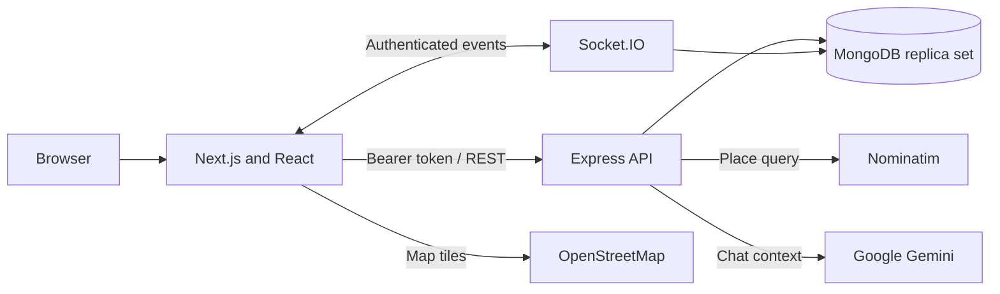

# Architecture and Technology

Updated: 26 November 2026.

## Architectural structure

DRECS is a two-application repository. The Next.js client handles presentation and browser interactions. The Express API owns authentication, authorization, validation and business rules. MongoDB stores operational records. Third-party services supply map tiles, place search and generated guidance.

Routes define access and input schemas; controllers apply business decisions; Mongoose models define storage and indexes. Shared policy helpers make transition and accounting rules testable independently of the interface. Client-side validation improves feedback, while server-side validation remains authoritative.

## Tools and their purpose

Versions below identify the major implementation families; lockfiles specify the installed dependency tree.

| Tool | Purpose and rationale |
| --- | --- |
| Next.js 14.2.3, React 18 | App Router pages, layouts, component state and client navigation |
| TypeScript 5 | Static contracts for both applications; complements runtime validation |
| Tailwind CSS 3, PostCSS, Autoprefixer | Shared styling, responsive layouts and CSS processing |
| Lucide React | Consistent interface icons |
| clsx, tailwind-merge | Conditional classes and resolution of conflicting utility classes |
| Axios | Client API requests and Bearer-token attachment |
| Express 4, Node.js | HTTP routing, middleware and external-provider requests |
| MongoDB, Mongoose 8 | Document persistence, indexes, schemas, optimistic concurrency and transactions |
| Zod 3 | Runtime validation, field constraints and normalized request bodies |
| jsonwebtoken | Signed access tokens and server verification |
| bcryptjs | Password hashing and comparison; registration respects bcrypt's byte limit |
| Socket.IO 4 | Authenticated notification delivery and data-refresh signals |
| Leaflet 1.9, react-leaflet 4 | Interactive maps, markers, bounds and geographic display |
| OpenStreetMap, Nominatim | Map tiles and explicit place/address lookup without a Google Maps key |
| Recharts 2 | Incident, shelter, offer and inventory visualizations |
| Google Gemini REST API | Generated disaster guidance; native fetch avoids a separate AI SDK |
| dotenv | Server configuration from an untracked environment file |
| cors, Morgan | Browser-origin configuration and request logging |
| Node test runner, assert | Unit assertions and automated workflow checks |
| mongodb-memory-server | Disposable replica sets for transaction and integration tests |
| ts-node, tsx, nodemon, rimraf | TypeScript execution, development reload and clean server builds |
| Git and GitHub | Source history, prototype checkpoint and repository documentation |

Multer remains in the dependency manifest from the prototype. Its presence does not mean a supported file-upload feature exists. Incident validation accepts a bounded list of HTTPS image URLs. No Python runtime is required by the application.

## Data model

| Model | Responsibility |
| --- | --- |
| `User` | Identity, hashed password, role, active flag and report quota metadata |
| `Incident` | Reporter, description, location, severity, publication review and response history |
| `VolunteerRequest` | Help offer, availability, contact, skills, owner and withdrawal state |
| `CoordinationMessage` | A private incident/person thread, sender, text and retry key |
| `Assignment` | Historical task records; new assignment mutations are disabled |
| `Shelter` | Location, contact, capacity, occupancy and operational status |
| `Resource` | Source quantity, available quantity, incident reservations and shelter reservations |
| `StorageLocation` | Warehouse or shelter source location reused by inventory |
| `ShelterNeed` | Requested quantity, committed quantity, fulfilled quantity and urgency |
| `SupplyTransfer` | Reservation, dispatch, receipt, return and damage totals for one shipment |
| `ShelterStock` | Received balance and consumption per shelter/resource pair |
| `StockMovement` | Transactional record of each supply movement |
| `Notification` | Recipient-specific updates and read state |

`AssistantQuota` remains a historical model from the retired supply assistant. The new disaster chatbot uses bounded process-local rate limits instead. No supply-planning AI route remains active.

## Core techniques

**Separate state machines.** Incident publication, incident response, help availability and stock movement represent different facts. One does not automatically prove another. See [workflow rules](docs/WORKFLOWS.md).

**Atomic stock changes.** MongoDB transactions group changes to source stock, demand, transfers, shelter stock and movement history. A failed write rolls back the operation. Conditional checks and Mongoose optimistic concurrency protect against stale updates. A replica set is mandatory.

**Idempotent requests.** Stable UUID request keys identify retryable demand, transfer, receipt and consumption operations. Unique indexes and content comparisons prevent retries from creating additional movements. Message requests also carry a retry key. Clients retain keys while retrying the same action.

**Geographic matching.** Source suggestions require the same normalized item, category and unit, sufficient available stock, an active source and a distinct destination. Haversine distance ranks candidate locations. This is straight-line proximity, not road routing or a guarantee of safe access.

**Notification-driven refresh.** Sockets authenticate with a token and current active account. The server assigns user and role rooms; clients cannot choose another user's identity. Successful authenticated mutations emit a generic `data_changed` signal. Clients retrieve fresh information through authorized REST requests. Stored notifications remain available after reconnecting; socket delivery is best effort.

**Aggregation for analytics.** MongoDB queries aggregate incident categories, severity, dates, shelter occupancy and resource usage. Public incident counters exclude unverified reports. Offers on active incidents replace task-completion-based participation metrics. Quantities with different units are not a meaningful combined stock total.

## AI design

The assistant is a server-mediated, generative integration. Every successful answer comes from Gemini; there is no FAQ answer fallback, vector database, retrieval pipeline, model training or autonomous agent workflow.

The server sends a structured system instruction separately from user/model conversation messages. It supplies disaster-management scope and a concise description of supported DRECS workflows. User text cannot select the model or change the system instruction through the API.

The request includes the current question and at most three completed exchanges. The server targets 40–90 words, sets a 450-token generation ceiling and accepts only completed responses of at most 120 words and 1,000 characters. Thought parts are excluded. Oversized, blocked or truncated output produces a retry/rephrase error rather than partial guidance. A 20-second provider timeout bounds waiting; the client allows 25 seconds.

The model has no database access, GPS access, current-alert feed or action tools. It is instructed not to invent live conditions, emergency numbers or dispatched help. These are safeguards, not proof of factual accuracy or immunity to prompt injection. See [security boundaries](docs/SECURITY.md).

## Interface conventions

Shared layouts provide persistent navigation, a mobile menu, consistent cards and form controls, visible focus states and reduced-motion support. Native dialogs manage focus and restore it on close. Status text uses operational wording rather than exposing implementation names. Read-only incident maps do not display location-editing actions. The chatbot renders plain text and keeps conversation state in browser memory.
