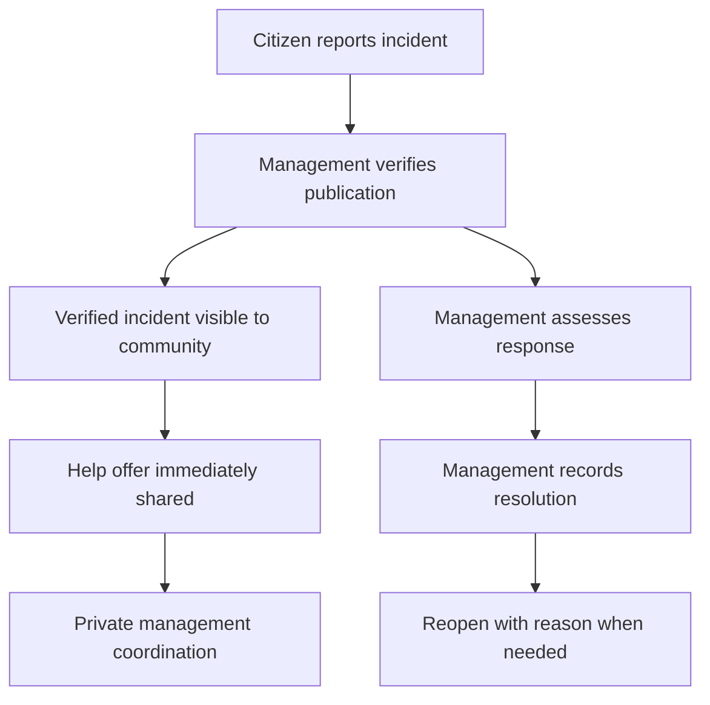

# System Workflows and Business Rules

## 1. Accounts and access

Public registration creates a citizen account. Citizens and volunteers can report incidents and offer help. Management (`authority`) verifies reports, coordinates people and manages shelters, inventory and supplies. Administrators have management access plus user-role and account-status controls. A volunteer label is not proof of professional qualification.

The API checks the current account's active status and role on authenticated requests rather than trusting an old role embedded in a token. Record ownership further restricts offers, private conversations and notifications.

## 2. Incident reporting and management response

Reporting requires a title, description, category, user-selected severity and geographic location. Reports begin pending verification. Each account can submit five reports per calendar day, using midnight in India as the shared reset boundary. Failed creation releases the reserved quota slot.

Verification controls visibility: a reporter and management can inspect a pending report; other community users cannot. Management can assess a pending report before making it public. Approval moves a newly reported incident into review, while rejection keeps it unavailable to the community.

Response decisions require an explanatory note and follow these transitions:

| Current state | Allowed next states |
| --- | --- |
| Reported | Under review, Response ongoing, Resolved |
| Under review | Response ongoing, Resolved |
| Historical Assigned | Response ongoing, Resolved |
| Response ongoing | Resolved |
| Resolved | Response ongoing, Closed |
| Closed | Response ongoing |

Management resolves an incident based on its assessment. Zero offers, unfinished historical assignments or outstanding resource reservations do not prevent resolution. Outstanding reservations generate reconciliation feedback; resolving does not physically return stock. Reopening is explicit and recorded. Rejected reports cannot receive normal response updates.

## 3. Help offers and private coordination

An offer contains availability, a mobile number and a description of the proposed help; skills are optional. It is immediately shared with management for an approved, active incident. No Accept, Start or Complete task sequence is required. An offer never automatically advances incident response.

Internally, new offers retain the `APPROVED` enum for compatibility. This means the offer was shared, not that management certified a person or assigned work. A partial unique index prevents duplicate active offers for the same person and incident. Owners can edit their own offer or withdraw it. Historical rejected/withdrawn offers remain readable.

Private threads are keyed by incident and participant. A reporter can contact management before verification. Helpers and historical assignees can access their own threads. Management selects the participant; helpers cannot read other helpers' conversations. New offers and messages are blocked after resolution/closure. The latest 100 messages remain readable. Reopening does not establish that previously offered availability is still current.

## 4. Shelter location, contact and occupancy

Shelter forms support three location methods: explicit place search, browser device location, or a pin on the map. Coordinates are stored internally without raw latitude/longitude fields in this form. Users must select a search result or map point; an address string alone does not establish coordinates. Moving the pin clears a previous address. Keyboard users can pan and select the map center.

Nominatim search is proxied through the authenticated API. Requests are limited to explicit searches with at least 1.1 seconds between provider requests, a bounded one-day cache, a timeout and response validation. Device location can be unavailable or denied; map selection remains usable. OpenStreetMap attribution remains visible.

A shelter contact accepts one Indian mobile number or one email address. Phone formatting and optional +91 are normalized; invalid prefixes, repeated digits and common sequential placeholders are rejected. Email formatting is validated and normalized. Neither check verifies reachability.

Capacity must be positive, occupancy nonnegative and occupancy no greater than capacity. An active shelter becomes full at capacity and reopens when space returns. An inactive shelter stays inactive. Editing a linked shelter location also updates its storage location and linked inventory coordinates transactionally.

## 5. Inventory and shelter supplies

Inventory answers **what is available at each source**. Shelter Supplies answers **what a shelter needs, what is arriving and what it has received**. Both use the same resource identifiers; users must not recreate a delivered shipment as a new inventory lot.

Create a source location once, then select it when adding stock. Older unlinked records can be linked. Incident allocations reserve stock for an incident; they do not claim dispatch. Equipment, vehicles and personnel remain in this reservation workflow. Consumable shelter requests cover Food, Water, Medical, Shelter Supplies and Other.

### Three supply views

| View | Operator action | Meaning |
| --- | --- | --- |
| Needed | Record additional demand, select matching stock | Demand is an additional request, not a target balance |
| On the way | Dispatch or prepare; record receipt, return or damage | Record physical events when they occur |
| Available here | Record distribution/usage | Only received stock is available to consume |

### Accounting rules

For a resource lot before dispatch:

`available = source quantity − incident reservations − shelter reservations`

For a shelter need:

`shortage = max(0, requested − committed − fulfilled)`

For a dispatched transfer:

`remaining in transit = sent − received − returned − damaged`

| Event | Source | Need | Destination |
| --- | --- | --- | --- |
| Reserve | Free availability decreases; physical stock remains | Committed increases | No received stock |
| Dispatch | Physical quantity and shelter reservation decrease | Commitment remains | Goods in transit |
| Cancel prepared transfer | Reservation released, availability restored | Commitment decreases | No receipt |
| Receive | No second source deduction | Commitment decreases, fulfilled increases | Received balance increases |
| Actual return | Physical quantity and availability restored | Commitment decreases, shortage reopens | No received balance |
| Damage/loss in transit | No restoration | Commitment decreases, shortage reopens | No received balance |
| Consume/distribute | No source change | Fulfilled remains historical delivery | Balance decreases, consumed increases |

Partial receipts, returns and damage cannot exceed the remaining shipment. An entirely received transfer becomes `RECEIVED`; a fully accounted mixed outcome becomes `SETTLED`. Prepared transfers can be cancelled; dispatched goods require explicit receipt, actual return or loss accounting. Returns and damage require an explanation. Retry keys prevent counting the same movement twice.

Example: start with 500 bottles. Dispatch 100: source 400, transit 100. Receive 80 and record 20 damaged: source 400, shelter 80, damage 20, shortage reopened by 20. Distribute 30: shelter balance 50, consumed 30. Total physical accounting remains 500 = 400 + 50 + 30 + 20.

Source suggestions compare normalized item name, category and unit exactly. They exclude unavailable/maintenance stock and incompatible locations, then rank by straight-line distance. Operators confirm suitability and transport conditions. The system does not convert units, infer substitutions, plan routes or use AI to move stock.

## 6. Notifications, analytics and assistant

Notifications persist per recipient and can be marked read individually or together. Authenticated sockets provide prompt updates; authorized API reads determine visible data. Generic refresh signals contain no private record payload.

Analytics summarize recorded data, not field-verified outcomes. Offer counts reflect shared availability. Shelter occupancy is entered by management. No task completion count determines whether an incident is resolved.

The disaster assistant answers general disaster-management and website questions through Gemini. It cannot file reports, change records, confirm safe roads or access live shelter capacity. Its output is bounded and displayed as text. Configuration, context limits and failure handling are documented in [Architecture](../PROJECT_INFORMATION.md#ai-design).
